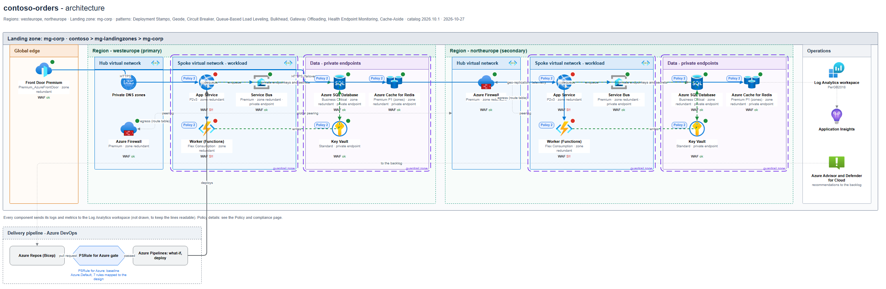
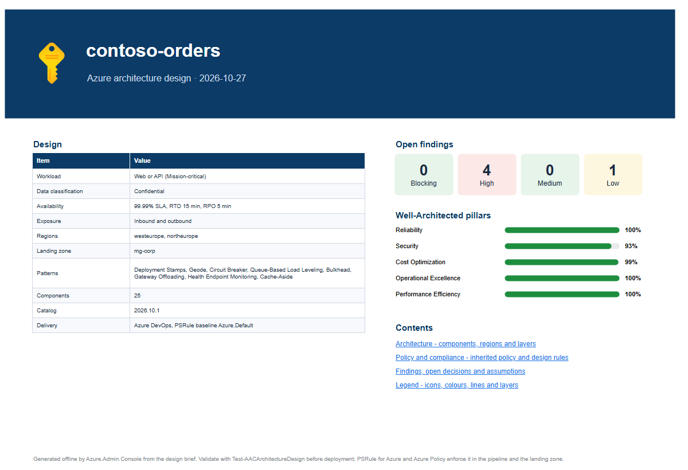
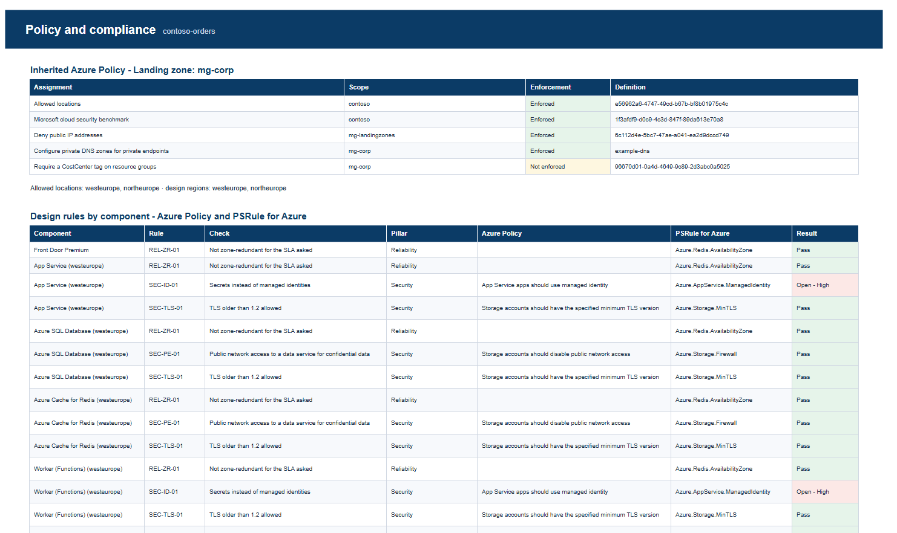
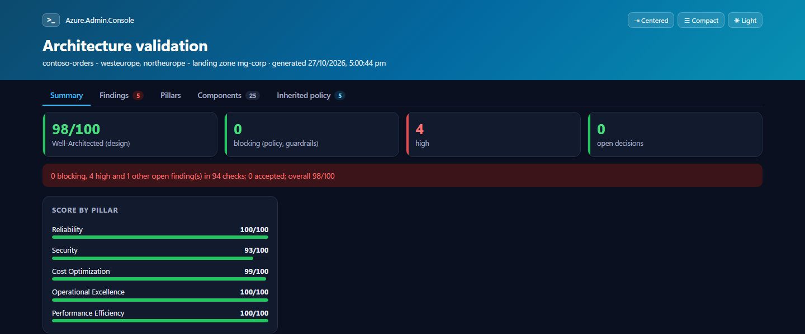

<div align="center">


# Azure.Admin.Console

**Azure, Microsoft 365 and Azure DevOps - assessed, reported and explained from PowerShell.**
Plain REST. No Az or Microsoft.Graph modules. Read-only by default.

[](https://github.com/ChendrayanV/Azure.Admin.Console/actions/workflows/ci.yml)
[](https://www.powershellgallery.com/packages/Azure.Admin.Console)
[](https://www.powershellgallery.com/packages/Azure.Admin.Console)
[](https://github.com/PowerShell/PowerShell)
[](#how-to-use-it)
[](LICENSE)
[](https://github.com/sponsors/ChendrayanV)

[How to use it](#how-to-use-it) · [What's new](#whats-new-in-0148) · [Architecture design](#architecture-design) · [Commands](#whats-inside) · [Full guide](GUIDE.md) · [Contribute](#contributing) · [Contact](#contact)

</div>

---

> **Azure doesn't stop at the subscription.** Every identity is governed in Microsoft 365, and every change ships through Azure DevOps. Assess one without the others and you're reading a third of the story - Azure.Admin.Console reads all three.

## Who it's for

| You are | You get |
|---|---|
| **Azure administrator** | Health, inventory, locks, diagnostics and errors - one command each |
| **Platform / cloud engineer** | Assessments for AKS, networks, storage, Cosmos DB, Service Bus, Log Analytics, WAF and ALZ |
| **Security and compliance** | Defender, Azure Policy, attack paths, access reviews, legacy authentication, NSGs |
| **FinOps** | Costs, anomalies, unused and under-used resources, Advisor savings |
| **Solution architect** | A guided design - patterns, components, policy checks, draw.io and Mermaid diagrams, decision records - before anything is deployed |
| **Microsoft 365 / Entra admin** | Tenant assessment, nested group membership, application permissions |
| **DevOps team** | An Azure DevOps assessment: pipelines, tools, SBOM, security, DORA - and a plan to move to GitHub |
| **Consultant** | Hand-over-ready HTML, PDF and CSV reports from a read-only sign-in |

## What's new in 0.14.8

Click a tab to open it.

<details open>
<summary><b>🏗️ Architecture design</b> &nbsp;·&nbsp; <i>new area, 6 commands</i></summary>

<br>

From a workload's requirements to a validated Azure design, diagrams and decision records - offline, in minutes.
`New-AACArchitectureBrief` · `Get-AACArchitecturePattern` · `New-AACArchitectureDesign` · `Test-AACArchitectureDesign` · `New-AACArchitectureDiagram` · `Export-AACArchitectureDecision` - see [Architecture design](#architecture-design).

</details>

<details>
<summary><b>🏢 Tenant assessment</b> &nbsp;·&nbsp; <i><code>Invoke-AACTenantAssessment</code> (was <code>Invoke-AACAssessment</code>)</i></summary>

<br>

The whole Azure environment in one report, now with the Well-Architected Framework, FinOps, PSRule and each resource's policy compliance - and a tab for each audience: **Identity and access** for security, **Architecture** for architects, **Operations** for admins and **Service delivery** for service managers. Each report goes where you say: `-HtmlPath`, `-PdfPath`, `-CsvPath`.

```powershell
Invoke-AACTenantAssessment -ManagementGroupId 'mg-landingzones' -HtmlPath .\tenant.html -PdfPath .\tenant.pdf
```

</details>

<details>
<summary><b>🔧 Azure DevOps assessment</b> &nbsp;·&nbsp; <i><code>Invoke-AACADOAssessment</code> (was <code>Get-AACADOInventory</code>), now with SBOM</i></summary>

<br>

Pipelines and the tools they run, security posture, DORA metrics - and a new **SBOM** tab: which pipelines publish a software bill of materials (Microsoft SBOM Tool, Syft, CycloneDX), and the components and licences in them.

```powershell
Invoke-AACADOAssessment -Organization contoso -UseAzureSignIn -HtmlPath .\ado.html
```

</details>

<details>
<summary><b>📊 Log Analytics workspace report</b> &nbsp;·&nbsp; <i><code>Invoke-AACLogAnalyticsWorkspaceAssessment</code>, tabbed HTML and PDF</i></summary>

<br>

Billable and free tables, settings, data collection rules and recommendations, now split into tabs like the other assessments, with a PDF.

```powershell
Invoke-AACLogAnalyticsWorkspaceAssessment -WorkspaceId $workspaceId -HtmlPath .\law.html -PdfPath .\law.pdf
```

</details>

Breaking changes (two renames, the tenant assessment's report parameters) are in the [changelog](CHANGELOG.md).

## Architecture design

**Design it before you deploy it, and draw it the way you'll deploy it.** Architecture reviews usually start from a whiteboard sketch that nobody keeps up to date, then find out at deployment that a policy denies it. The Architecture commands turn the conversation into a design: they ask the questions an Azure architect would ask, pick the [cloud design patterns](https://learn.microsoft.com/azure/architecture/patterns/) that fit, lay out the components, check them against the Well-Architected Framework and your landing zone's Azure Policy, and draw the result. The diagram, the findings and the decision records all come from the same model, so they agree.

| Step | Command | What you get |
|:---:|---|---|
| 1 | `New-AACArchitectureBrief` | About 20 probe questions - business, reliability, security, performance, data, cost, operations. Answer them at the prompt, from a hashtable or a file; whatever isn't answered is listed as an assumption |
| 2 | `Get-AACArchitecturePattern` | 15 patterns ranked for the brief (Cache-Aside, Queue-Based Load Leveling, Deployment Stamps, Geode...), each with why it fits and its trade-offs |
| 3 | `New-AACArchitectureDesign` | The components and their settings: SKUs, zone redundancy, private endpoints, identity, hub and spoke, a second region when the RTO or SLA needs one. Signed in, it reads the landing zone's inherited policy and allowed locations |
| 4 | `Test-AACArchitectureDesign` | Findings by pillar and severity, each mapped to its Azure Policy definition and PSRule for Azure rule; *Blocking* when the landing zone would deny it. `-FailOnGap` fails a pipeline |
| 5 | `New-AACArchitectureDiagram` | Mermaid, Markdown and a multi-page **draw.io** diagram with Azure icons |
| 6 | `Export-AACArchitectureDecision` | Architecture decision records: the topology, each pattern, each accepted risk with its owner and review date |

```powershell
$brief  = New-AACArchitectureBrief -Name 'contoso-orders'                    # asks the questions
$design = Get-AACArchitecturePattern -Brief $brief -RecommendedOnly |
          New-AACArchitectureDesign -Brief $brief -LandingZone 'mg-corp' -OutPath .\contoso-orders.design.json
Test-AACArchitectureDesign -Design $design -HtmlPath .\validation.html
New-AACArchitectureDiagram -Design $design -Path .\diagrams                   # .mmd, .md, .drawio
Export-AACArchitectureDecision -Design $design -Path .\adr -Owner 'Orders team'
```

**The diagram.** `New-AACArchitectureDiagram` writes a draw.io file you can open in the desktop app, [app.diagrams.net](https://app.diagrams.net) or VS Code, and keep editing. It isn't a picture:

- **Azure icons** inside real containers: landing zone, region, hub and spoke virtual networks, data tier, operations, delivery pipeline. Move a box and what's in it moves too.
- **A status dot** on every component for its worst open finding: green, amber or red.
- **Shape data** on every component (Edit > Edit Data): service, SKU, region, zone redundancy, private endpoint, identity, open findings.
- **Layers** you can turn on and off: WAF badges, Azure Policy, guardrail zones, the PSRule gate, Advisor and Defender recommendations.
- **Five pages:** a cover, the architecture, policy and compliance, the findings, and a legend.

<table>
<tr>
<td colspan="2" align="center"><b>Architecture</b> - two regions in a landing zone, Azure icons, finding dots, policy chips, guardrail zones<br></td>
</tr>
<tr>
<td width="50%" align="center"><b>Cover</b> - facts, open findings, pillar scores<br></td>
<td width="50%" align="center"><b>Policy and compliance</b> - its own tab<br></td>
</tr>
<tr>
<td colspan="2" align="center"><b>Validation report</b> - <code>Test-AACArchitectureDesign -HtmlPath</code><br></td>
</tr>
</table>

<sub>Snapshots from a fictional design (contoso-orders) in a fictional landing zone.</sub>

Everything except reading the landing zone runs offline, so a design can be reviewed before there is a subscription for it. The walkthrough is in [the guide](GUIDE.md#architecture-design).

## What's inside

87 commands. Every one gives a **console view**, **objects**, and **CSV, HTML and PDF** reports.

| Area | Commands |
|---|---|
| **Design** 🆕 | `New-AACArchitectureBrief` · `Get-AACArchitecturePattern` · `New-AACArchitectureDesign` · `Test-AACArchitectureDesign` · `New-AACArchitectureDiagram` · `Export-AACArchitectureDecision` |
| **Assess** | `Invoke-AACTenantAssessment` · `Invoke-AACWafAssessment` · `Invoke-AACGovernanceAssessment` · `Invoke-AACPSRule` · `Test-AACGoLiveReadiness` · `Invoke-AACAksAssessment` · `Invoke-AACFunctionAppAssessment` and 11 more |
| **See** | `Show-AACDashboard` · `Get-AACInventory` · `Show-AACResourceMap` · `Show-AACNetworkTopology` · `Get-AACDependencyGraph` |
| **Cost** | `Show-AACCost` · `Get-AACCostAnomaly` · `Get-AACUnusedResource` · `Get-AACResourceUtilization` · `Get-AACAdvisorRecommendation` |
| **Secure** | `Get-AACSecurityPosture` · `Get-AACAttackPath` · `Get-AACAccessReview` · `Get-AACNetworkSecurityGroup` · `Get-AACLegacyAuthentication` |
| **Plan IPs** | `Get-AACIPAMReport` - your address plan, every IP address, overlaps and the next free ranges |
| **Govern** | `Get-AACPolicyState` · `Get-AACComplianceGap` · `Get-AACConfigurationDrift` · `Get-AACResourceLock` · `Test-AACAzureLimit` |
| **Operate** | `Get-AACResourceHealth` · `Get-AACChangeHistory` · `Get-AACResourceError` · `Invoke-AACHealthCheck` · `Get-AACFailoverReadiness` · `Show-AACServiceBusEntity` 🆕 |
| **Microsoft 365** | `Invoke-AACM365Assessment` · `Get-AACEntraGroupMembership` · `Get-AACApplicationPermission` · `New-AACApplicationPermission` |
| **Azure DevOps** | `Invoke-AACADOAssessment` |
| **Build** | `Export-AACTerraform` · `Get-AACTerraformPlan` · `Deploy-AACStorageAccount` |

Every command, with examples: [**the full guide**](GUIDE.md) and [**docs/**](docs/).

## How to use it

```powershell
Install-PSResource -Name Azure.Admin.Console        # or: Install-Module Azure.Admin.Console -Scope CurrentUser
Connect-AAC                                         # sign in once, in your browser

Show-AACDashboard                                         # the estate on one screen
Invoke-AACTenantAssessment -HtmlPath .\tenant.html        # the whole environment, as a report
Invoke-AACADOAssessment -Organization contoso -UseAzureSignIn -HtmlPath .\ado.html
```

The same switches work everywhere:

| Switch | What it does |
|---|---|
| `-HtmlPath` · `-PdfPath` · `-CsvPath` | Write a report |
| `-NoDisplay` | Return objects only, for scripts |
| `-PassThru` | Show the view and return the objects |
| `Get-Help <command> -Full` | The permissions it needs, and examples |

PowerShell 7.2+ on Windows, Linux and macOS. PDF reports need Windows and PowerShell 7.4+.
Only `Deploy-AACStorageAccount` and `New-AACApplicationPermission` change anything in Azure or Entra ID, and both support `-WhatIf`.

<a href="https://www.youtube.com/watch?v=xBkStQ1H2OU">Watch the walkthrough on YouTube</a>

## Contributing

New commands, fixes, ideas and bug reports are all welcome - you don't need to be an expert to help.
Open an [issue](https://github.com/ChendrayanV/Azure.Admin.Console/issues) to say what you'd like to work on, and we'll shape it together.

<details>
<summary><b>How the project is laid out - and how to add a command</b></summary>

```text
Azure.Admin.Console.psd1 / .psm1   the module: loads each area of src\, Core first
src\
  Core\     sign-in, REST helpers, console views, CSV / HTML / PDF reports
  Azure\    commands scoped to subscriptions and management groups
  M365\     commands for the Entra ID / Microsoft 365 tenant
  DevOps\   commands for Azure DevOps
  Architecture\  architecture design: brief, patterns, design, rules, diagrams, decisions
    <Area>\Public\    one exported command per file
    <Area>\Private\   its helpers
Tests\<Area>\         Pester tests, fully mocked - no Azure sign-in needed
Tests\Fixtures\       fake API answers the tests read
```

To add a command, copy a sibling:

1. `src\<Area>\Public\Verb-AACThing.ps1` - the command, with comment-based help.
2. `src\<Area>\Private\` - turn API rows into objects, then the view and reports.
3. Add it to `FunctionsToExport` in `Azure.Admin.Console.psd1`.
4. `Tests\<Area>\Thing.Tests.ps1` with a fixture in `Tests\Fixtures\`.

House rules: REST through the Core helpers (no Az or Graph modules), read-only unless the command supports `-WhatIf`, and `Set-StrictMode -Version Latest` clean.

```powershell
Invoke-Pester -Path ./Tests/Azure/Cost.Tests.ps1 -Output Detailed   # one test file while you work
./build.ps1 -Task Docs                                             # after changing help
./build.ps1                                                        # docs, every test, analyzer, package
```

</details>

## Credits

With thanks to the people whose work and ideas shaped this module:

| GitHub |
|:---:|
|  **Shashi Shetty** [](https://github.com/shashi-create) |

Built on [Spectre.Console](https://spectreconsole.net), [PDFsharp and MigraDoc](https://www.pdfsharp.com) and [PSRule for Azure](https://azure.github.io/PSRule.Rules.Azure/).

## Contact

**Chendrayan Venkatesan** - Azure | DevSecOps | PowerShell

[](https://github.com/ChendrayanV)
[](https://www.linkedin.com/in/chendrayanv/)
[](https://twitter.com/ChendrayanV)
[](https://about-powershell.com)

Questions and bugs: [open an issue](https://github.com/ChendrayanV/Azure.Admin.Console/issues/new).

<sub>MIT licensed - see [LICENSE](LICENSE).</sub>
